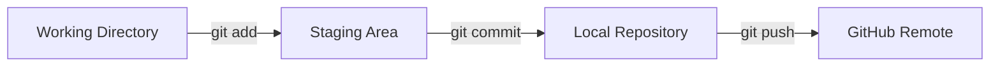

# 나의 포트폴리오

## 소개
Git과 GitHub를 배우며 만든 첫 웹페이지이다.

## 배포 주소
https://github.com/drg0208/lemonade

## 기술 스택

| 구분 | 기술명 |
| :--- | :--- |
| 언어 | Python, Nodejs, Java, C, C++, Swift, R |
| 형상관리 | Git, GitHub |
| 배포 | GitHub Pages |

## Git 흐름

## 향후 추가 계획
- [x] 기본 소개와 기술 스택 작성
- [ ] 다크 모드 토글 기능 추가
- [ ] 프로젝트 카드 반응형 레이아웃 보완